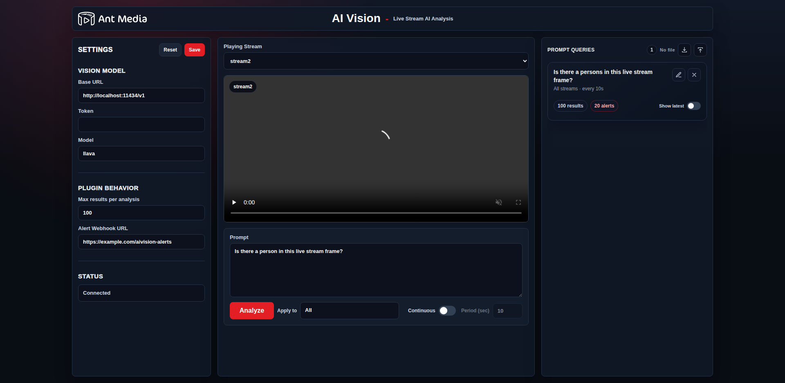
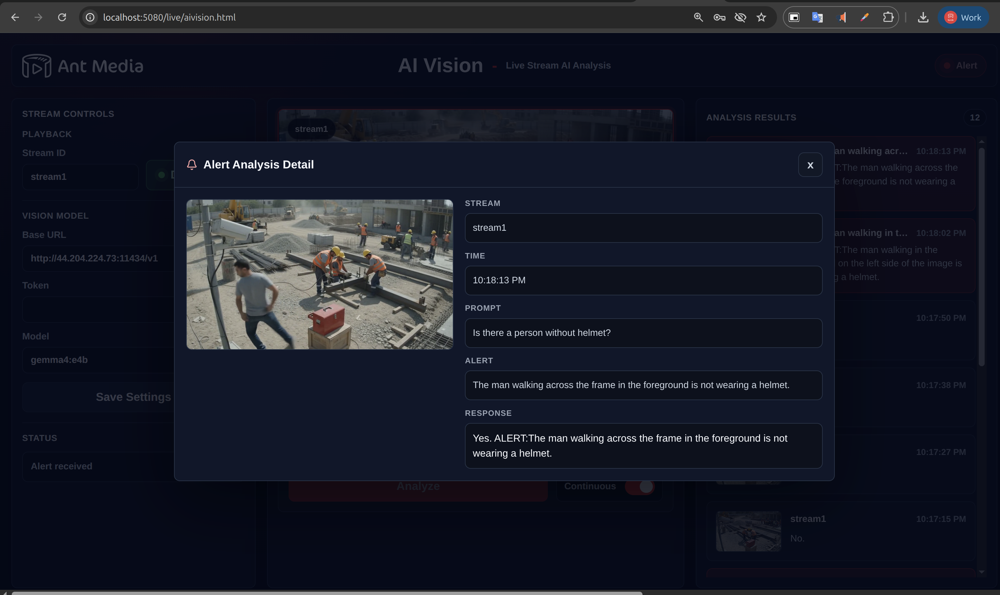

# AI Vision Plugin

AI Vision adds prompt-based image analysis to live streams in Ant Media Server (AMS). It captures the latest frame, sends it to an OpenAI-compatible vision endpoint, and returns the model response together with the analyzed image.

The plugin supports one-shot analysis and server-side periodic queries. A query can target selected streams or `All`; an `All` periodic query automatically includes streams that start later.



## Features

- Automatically discovers active streams; no registration request is required.
- Plays any active stream selected from the `Playing Stream` list.
- Runs one-shot analysis on one, several, or all active streams.
- Runs periodic analysis on the server after the UI starts the query.
- Identifies every periodic query with a generated request ID.
- Shows result and alert counts, history, and analyzed images per query.
- Supports editing and cancelling active queries.
- Exports and imports query definitions without exporting results.
- Sends alert results to an optional webhook URL.
- Stores plugin settings in the AMS application settings.
- Limits retained results independently for each periodic query.

## Installation

```bash
wget -qO- https://raw.githubusercontent.com/ant-media/Plugins/master/AIVision/install.sh | sudo sh
```

Open the page for the AMS application where the plugin is installed:

```text
http://your-ant-media-server:5080/<app-name>/aivision.html
```

For example: `http://localhost:5080/live/aivision.html`.

## Vision Model Configuration

AI Vision calls an OpenAI-compatible `/v1/chat/completions` endpoint. It can use a hosted provider or a local/on-premise model.

### OpenAI

```text
Base URL: https://api.openai.com/v1
Token: your OpenAI API key
Model: gpt-4o-mini
```

### Ollama

```text
Base URL: http://<ollama-host>:11434/v1
Token: leave empty
Model: llava
```

See [Ollama Setup for AI Vision](doc/OLLAMA.md) for local and Docker setup instructions.

### Plugin Behavior

- `Max results per analysis`: retained result limit for each periodic query, from 1 to 1000. The default is 100.
- `Alert Webhook URL`: optional URL that receives alert results as JSON via HTTP POST.

`Save` writes these values to the current application's `AppSettings.customSettings` under `plugin.aivision`. `Reset` discards unsaved form changes and reloads the values stored on the server.

Default settings are available before the first save:

```json
{
  "baseUrl": "http://localhost:11434/v1",
  "token": "",
  "model": "llava",
  "webhookUrl": "",
  "maxResultsPerAnalysis": 100
}
```

## Using the Dashboard

1. Select the stream to watch from `Playing Stream`. The list refreshes automatically.
2. Enter a prompt.
3. Choose `Apply to: All` or select specific active streams.
4. Leave `Continuous` disabled for one-shot analysis, or enable it and set a period.
5. Click `Analyze`.

One-shot `All` analysis creates one result for every stream active when the button is clicked. Periodic `All` analysis remains active and also applies to streams that start later.

Periodic queries appear under `Prompt Queries`. Each card shows the prompt, target, period, result count, alert count, and edit/delete controls. `Show latest` is disabled by default; enable it to reveal the latest response and analyzed image.

Click a result or alert count to open its list, then select an item for its complete response, prompt, stream, time, alert information, and frame.

The query panel's download and upload buttons save and load query definitions. Export files contain the prompt, period, targets, and `applyToAll` flag. Results are intentionally excluded.

## Alerts and Webhooks

For a yes/no prompt, the plugin asks the model to include this marker when the answer is yes:

```text
ALERT:{explanation}
```

Responses containing this marker are counted and styled as alerts. If `Alert Webhook URL` is configured, the complete alert response is posted to it as JSON. Non-alert results are not posted.



## REST API

All endpoints are scoped to an AMS application:

```text
http://<host>:5080/<app-name>/rest/v2/aivision
```

### One-shot analysis

```http
POST /analyze
Content-Type: application/json

{
  "streamId": "stream1",
  "prompt": "Is there a person in this frame?",
  "lastFrameTimestamp": 0
}
```

### Start a periodic query

Selected streams:

```http
POST /periodic
Content-Type: application/json

{
  "prompt": "Is there smoke?",
  "period": 10,
  "streamIds": ["stream1", "stream2"],
  "applyToAll": false
}
```

All streams, including streams that start later:

```json
{
  "prompt": "Is there smoke?",
  "period": 10,
  "streamIds": [],
  "applyToAll": true
}
```

`period` must be between 1 and 86400 seconds. A successful response returns the generated request ID in `dataId`; use that ID for subsequent operations.

### List, read results, and cancel

```http
GET /periodic
GET /periodic/{requestId}/results?after=0
DELETE /periodic/{requestId}
```

The optional `after` value is a result ID and returns only newer results.

### Read and update settings

```http
GET /settings
POST /settings
```

Example update body:

```json
{
  "baseUrl": "http://localhost:11434/v1",
  "token": "",
  "model": "llava",
  "webhookUrl": "https://example.com/aivision-alerts",
  "maxResultsPerAnalysis": 100
}
```

## Local Development

Build the plugin package with:

```bash
mvn clean package -Dmaven.javadoc.skip=true -Dmaven.test.skip=true -Dgpg.skip=true
```

The package is generated at `target/aivision.zip`. For the local AMS checkout configured by this project, build and copy the plugin and UI with:

```bash
./redeploy.sh
```

### Fake AI Server

The dependency-free fake server implements the OpenAI-compatible chat completions endpoint for UI, periodic-query, and alert testing:

```bash
python3 tools/fake_ai_server.py
```

It listens at `http://127.0.0.1:11434/v1`, logs each prompt, and returns an acknowledgement. For yes/no prompts it returns `Yes` with an `ALERT:` marker on every fifth request and `No` for the others.

```bash
curl http://127.0.0.1:11434/health
```

Use `http://localhost:11434/v1`, an empty token, and model `llava` in the UI.
